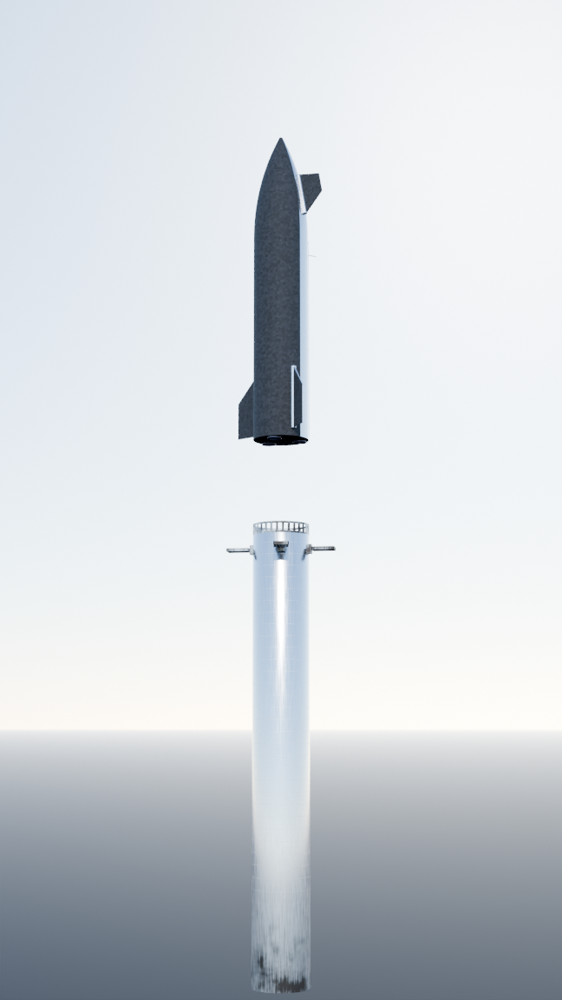

# Procedural Starship stack generator (Blender)

`starship_generator.py` builds a parametric, Starship-class two-stage stack in Blender with working hinges and keyframed animation. It is one self-contained script with no add-ons and no `bpy.ops` in the build path, so it runs headless.



## What it builds

| Part | Detail | Moves? |
|---|---|---|
| Ship hull | Tangent-ogive nose with a blunted tip, 9 m barrel, raceway, thrust plate | Separates from the booster |
| Heat shield | Per-face tile material across a configurable windward arc (centred on −Y) | — |
| Forward / aft flaps | Trapezoid panels, tiled on the windward face; the forward hinge axis follows the nose taper | Deploy from stowed, then differential "flutter" |
| Payload door | Curved panel hinged on its top edge, with a dark aperture behind it | Swings outward |
| Engines | Raptor-like engines (bell, chamber, powerhead, turbopumps). There is one shared mesh per type, so 33 + 6 engines cost 2 meshes | — |
| Booster | Sooted steel, vented hot-staging ring, forward dome, 3 + 10 + 20 engine rings | — |
| Grid fins | Lattice fins on a radial shaft, with actuator housings | Rotate about the shaft |

Every hinge uses the same pattern:

```
Mount (static empty: position + orientation) → Hinge (empty, rotates on ONE local axis) → Panel
```

Each hinge also gets a `HingeStops` Limit Rotation constraint derived from its keyed range, so posing it by hand can't over-rotate it.

## Run it

```bash
blender -b --factory-startup --python starship_generator.py -- --remove-default-cube --save starship.blend
```

```bash
blender -b --python starship_generator.py -- --set ship.length=50 --set grid_fins.azimuths_deg=[0,120,240] --render out.png --frame 120
```

```bash
blender -b --python starship_generator.py -- --params my_overrides.json --render frames/ss_ --animation --log-json run.json
```

You can also open the script in Blender's Text Editor and press **Run Script** to build with the defaults.

It works with the PyPI module too. Install `bpy` first:

```bash
pip install bpy
```

Then call the script directly with Python:

```bash
python starship_generator.py -- --dump-params > defaults.json
```

All script arguments go after `--`.

| Flag | Purpose |
|---|---|
| `--params FILE` | JSON overrides. A partial file is fine. Unknown keys are rejected and the error lists the valid ones |
| `--set k.sub=VALUE` | Override one parameter, repeatable. The value is parsed as JSON |
| `--dump-params` | Print every parameter and its default |
| `--force` | Ignore the cache and rebuild everything |
| `--save`, `--render`, `--frame`, `--animation` | Output |
| `--log-json FILE` | Machine-readable report: timings per stage, built vs reused counts, hinge list, AI usage |

To call it from Python:

```python
import starship_generator as sg

p = sg.StarshipParams()
p.flaps.stowed_angle_deg = 80
report = sg.generate(p)        # returns a dict; raises ValueError on bad parameters
```

## Parameters

There are 13 groups and roughly 120 values. Run `--dump-params` for the full list.

- `hull`, `ship`, `booster`, `engines`: dimensions and engine layout
- `flaps`, `grid_fins`, `payload_door`: panels and hinges
- `materials`, `environment`, `camera`, `render`, `animation`: look and motion
- `include_booster`: set to `false` for the ship alone

`validate()` catches impossible combinations before anything is touched, for example nozzles overlapping or poking through the skirt, flaps off the nose cone, or a door wider than the hull.

## Incremental rebuilds

Each mesh, material, the world and the animation store a hash of only the parameters that shape them. Re-running with unchanged parameters reuses all of them. Measured on Blender 5.3 (CPU, headless):

| Run | Scene build time | Meshes built / reused |
|---|---|---|
| Cold | 0.067 s | 15 / 3 |
| Re-run, no changes | 0.004 s | 0 / 18 |
| Grid fins moved | — | 0 / 18 (fins re-placed, animation re-keyed, one stale fin removed) |
| Tile size changed | — | 0 / 18, 1 material rebuilt |

Objects the current parameters no longer need are deleted automatically. The script only ever deletes objects it tagged (`starship_gen` custom property), never yours.

## Timing and AI usage cost

The log reports wall time per stage and the total, and so does `--log-json`.

On cost: the script makes **no AI or API calls, so its runtime AI cost is exactly US$0.00**. The cost of the AI session that wrote or tuned it isn't visible from inside Blender, so the script won't guess it. To include that cost, point `STARSHIP_GEN_AI_LEDGER` at a JSON list:

```json
[{"source": "design session", "input_tokens": 0, "output_tokens": 0, "usd": 0.0}]
```

The script then sums the entries and logs them verbatim.

## Accuracy

The defaults are approximate public figures for a Block 2-era vehicle. Treat anything below **high** confidence as a starting point to tune.

- **High:** 9 m diameter; 33 booster engines in a 3 + 10 + 20 arrangement; 6 ship engines (3 sea-level, 3 vacuum); four flaps; a vented hot-staging ring; Super Heavy grid fins rotate on their shafts rather than folding.
- **Moderate:** stack height of about 123 m (ship about 52 m, booster about 71 m), and the nozzle sizes.
- **Low:** ring pitch, flap and grid-fin planforms, grid-fin azimuths, payload door size and position, and the tile scale.

Deliberate stylisation:

- Tiles use a Voronoi pattern, not true hexagons.
- The tile boundary follows the mesh's facets.
- The payload door is a hinged panel. The real "Pez" door's mechanism differs.

No logos or markings are modelled.
